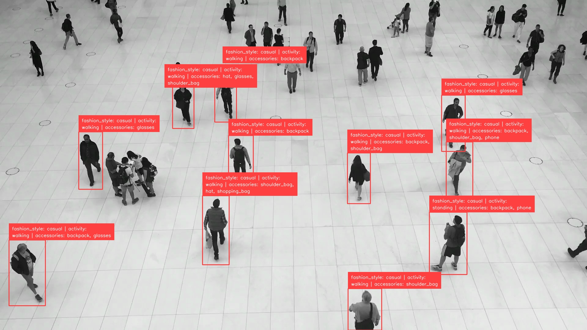
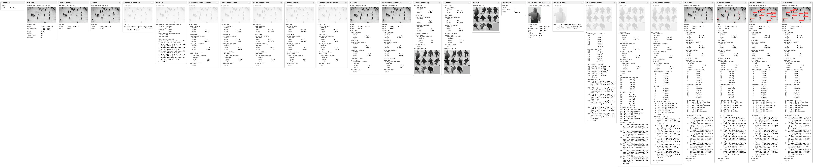

# Detect and Attribute

Pipeline source: [run_detect_and_attribute.py](https://github.com/trained-by-humans/ml-pipes-supervision/blob/main/examples/run_detect_and_attribute.py)

Detection models locate objects and assign class labels, but a label such as
`person` does not tell you what someone is wearing, doing, or carrying.
[Detect and Describe](detect_and_describe.md) adds that information by asking a
vision-language model (VLM) about each detected subject.

Free-form descriptions are useful for open-ended questions, but their wording
can vary. To filter or count detections by a particular property, it helps to
have named attributes with consistent label values.

This recipe builds on the same detection-to-VLM pipeline, asking for attributes
from supplied label sets instead of free-form text. One query per subject can
return fashion style, activity, and a collection of accessories. We parse and
validate the answers, then attach the attribute fields and raw response to their
detection for annotation or further processing.

## Install dependencies

This example uses local RF-DETR Small and Qwen3-VL, but the same structure applies
to other detectors and VLMs. Install the detector integration and local VLM runtime:

```bash
python -m pip install "ml-pipes-supervision[inference]"
python -m pip install "transformers>=4.57.0,<6" "torch>=2.6" "Pillow>=10"
```

Save [run_detect_and_attribute.py](https://raw.githubusercontent.com/trained-by-humans/ml-pipes-supervision/main/examples/run_detect_and_attribute.py)
and its helper files [qwen_local.py](https://raw.githubusercontent.com/trained-by-humans/ml-pipes-supervision/main/examples/qwen_local.py),
[run_detect_and_describe.py](https://raw.githubusercontent.com/trained-by-humans/ml-pipes-supervision/main/examples/run_detect_and_describe.py),
and [common.py](https://raw.githubusercontent.com/trained-by-humans/ml-pipes-supervision/main/examples/common.py)
beside your own script. These provide the example-local attribute helpers and VLM
adapter imported below; they are not package operators. Model weights download
on first use.

> [!TIP]
> CPU inference can be slow: the default 2B VLM's float32 weights alone need roughly 8 GB,
> plus runtime memory. Use `device="mps"` or `"cuda"` if available.

## Isolate the target subjects

Before assigning attributes, detect the subjects, filter out irrelevant or
uncertain detections, and crop each remaining subject. Filtering avoids
unnecessary VLM calls, while cropping gives the model a focused view of the
subject whose attributes we want to extract.

See [Detect and Describe](detect_and_describe.md#detect-and-filter-subjects) for a
detailed explanation of detection, filtering, and crop preparation.

```python
import numpy as np
from supervision.assets import ImageAssets, download_assets

from ml_pipes.core import Pipeline
from ml_pipes.standard import Recall, Select, Store
from ml_pipes.supervision import Detections, ImageToArray
from ml_pipes.supervision.inference import RoboflowInference
from ml_pipes.vision import Decode, LoadFile

source_path = download_assets(ImageAssets.PEOPLE_WALKING, directory=".")

pipeline = Pipeline(
    [
        LoadFile(),
        Decode(),
        ImageToArray(),
        Store("source_image"),  # Keep the image for cropping and annotation.
        RoboflowInference(model_id="rfdetr-small", confidence=0.5),
        Select(0),  # Select the result for this image.
        Detections.FromInference(),
        Detections.Filter(lambda detections: np.isin(detections.class_id, (1,))),  # RF-DETR: 1 = person.
        Detections.Filter(lambda detections: detections.confidence >= 0.5),
        Detections.NMS(threshold=0.5),
        Detections.ScaleBoxes(1.1),  # 5% padding per side.
        Recall("source_image", prepend=True),
        Detections.ClipBoxes(rounding="outward", invalid_policy="drop"),
        Detections.Crop(),  # (detections, BGR crops), aligned in the same order.
    ],
    auto_validate=True,
)
```

## Define the attributes and candidate labels

Describe the visible distinction you want the VLM to make. `fashion_style` and
`activity` each select one label; `accessories` can return several labels with
`multiple=True`. Add other visible attributes, such as clothing color or carried
objects, as additional named fields.

```python
from qwen_local import LocalQwen3VL
from run_detect_and_attribute import (
    Attribute, ParseAttributes, build_attribute_prompt, format_attributes,
)

attributes = {
    "fashion_style": Attribute(
        description="Overall visual style of the outfit",
        # Candidate labels accept "name: description", or just "name".
        labels=("casual: relaxed everyday clothing", "formal: office attire, such as a suit"),
    ),
    "activity": Attribute(
        description="Visible body posture or movement",
        labels=("walking", "standing", "sitting"),
    ),
    "accessories": Attribute(
        labels=("backpack", "shoulder_bag", "handbag", "shopping_bag", "hat", "glasses", "phone"),
        multiple=True,  # A subject may have several accessories.
    ),
}
```

## Assign attributes to each subject

Ask the VLM about each crop using
[Scatter/Gather](https://ml-pipes.com/regions/#scatter-gather), keeping the
responses in detection order. Each request asks for all configured attributes.

```python
from ml_pipes.standard import Gather, Pick, Scatter
from ml_pipes.vision import ConvertColorSpace

pipeline = Pipeline(
    [
        ...,  # Earlier operators unchanged.
        Detections.Crop(),
        Store("detections", source=0),  # Keep the padded, clipped detections.
        Pick(1),  # Pass only the crops to the VLM.
        Scatter(max_concurrency=1),  # This local Qwen adapter requires sequential calls.
        ConvertColorSpace(output_color_space="RGB"),
        LocalQwen3VL(
            prompt=build_attribute_prompt(attributes),  # Request all configured attributes as JSON.
            model_id="Qwen/Qwen3-VL-2B-Instruct",
            device="cpu",
            max_tokens=256,  # Cap generated response length.
        ),
        Gather(),  # Collect responses in crop order.
    ],
    auto_validate=True,
)
```

## Parse the model responses

The Qwen3-VL setup used here does not support schema-constrained responses.
Asking for JSON in the prompt still produces text, so we must parse
it and validate the attribute names, label values, and single- or multi-value
structure before attaching it to detections.

`Gather()` returns a list of response strings, one per crop. `ParseAttributes`
converts that list into a dictionary of aligned lists: one column per attribute,
plus the raw `response` column. Each column has one entry per detection in crop
order. For example, this response from the illustrated run:

````python
response = """```json
{
  "fashion_style": "casual",
  "activity": "standing",
  "accessories": [
    "backpack",
    "phone"
  ]
}
```"""

fields = ParseAttributes(attributes)([response])
````

produces:

```python
{
    "fashion_style": ["casual"],
    "activity": ["standing"],
    "accessories": [["backpack", "phone"]],  # Keep the collection within its row.
    "response": [response],  # The original JSON text, unchanged.
}
```

Missing or invalid values become `"unknown"` (or `["unknown"]` for multi-value
fields). An empty list means no listed accessories are visible.

??? note "Example-local ParseAttributes implementation"

    This operator lives in the downloaded example, not `ml_pipes.supervision`.

    ````python
    import json
    from collections.abc import Mapping
    from typing import Any

    from ml_pipes.operator import Operator
    from run_detect_and_attribute import (
        parse_named_text, prepare_attributes, unique_json_object,
    )


    @Operator
    class ParseAttributes:
        def __init__(self, attributes: Mapping[str, Attribute]) -> None:
            self.attributes = prepare_attributes(attributes)
            self.labels = {
                name: {parse_named_text(label, "candidate label")[0] for label in attribute.labels}
                for name, attribute in self.attributes.items()
            }

        def __call__(self, responses: list[str]) -> dict[str, list[Any]]:
            fields: dict[str, list[Any]] = {name: [] for name in self.attributes}
            for response in responses:
                text = response.strip()
                # Accept JSON wrapped in a Markdown code fence as well as bare JSON.
                if text.startswith("```") and text.endswith("```"):
                    lines = text.splitlines()
                    if lines[0].strip() in ("```", "```json"):
                        text = "\n".join(lines[1:-1])
                try:
                    payload = json.loads(text, object_pairs_hook=unique_json_object)
                    if not isinstance(payload, dict):
                        payload = {}
                except ValueError:
                    payload = {}  # Malformed JSON or duplicate keys: this row is unknown.

                for name, attribute in self.attributes.items():
                    value = payload.get(name)
                    allowed = self.labels[name] | {"unknown"}
                    if attribute.multiple:
                        valid = isinstance(value, list) and all(
                            isinstance(item, str) and item in allowed for item in value
                        ) and ("unknown" not in value or value == ["unknown"])
                        fields[name].append(value if valid else ["unknown"])
                    else:
                        fields[name].append(value if isinstance(value, str) and value in allowed else "unknown")
            fields["response"] = responses  # Keep the original text for inspection.
            return fields
    ````

## Attach attributes to detections

`Detections.AttachData()` attaches several fields to `detections.data` at once,
including the parsed attributes and raw responses here. Like `AttachDataField`,
each key must be a non-empty string and each value must be a list or NumPy array
with one entry per detection, in the same order. Nested per-detection collections
are preserved; existing keys require `overwrite=True` to replace them.

Attach the parsed columns to the saved detections without changing their boxes,
class IDs, or confidence scores.

```python
pipeline = Pipeline(
    [
        ...,  # Earlier operators unchanged.
        Gather(),
        ParseAttributes(attributes),  # JSON text -> aligned attribute columns.
        Recall("detections", prepend=True),
        Detections.AttachData(),
    ],
    auto_validate=True,
)
```

For the sample response above (detection index `1` in the illustrated run), the
attached data reads:

```python
detections.data["fashion_style"][1]  # "casual"
detections.data["activity"][1]      # "standing"
detections.data["accessories"][1]   # ["backpack", "phone"], not a flattened string.
detections.data["response"][1]      # The original JSON response string shown above.
```

## Annotate the result

Show the attributes on each subject's crop region in the original image.

```python
from ml_pipes.supervision import BoxAnnotator, LabelAnnotator, PlotImage

pipeline = Pipeline(
    [
        ...,  # Earlier operators unchanged.
        Detections.AttachData(),
        Recall("source_image", prepend=True),
        BoxAnnotator(),  # Default class colors, as in Detect and Describe.
        LabelAnnotator(
            label_formatter=lambda detection: format_attributes(detection.data, attributes),
            smart_position=True, max_line_length=40,  # Wrap longer multi-attribute labels.
        ),
        PlotImage(at=0),  # Display the image from (annotated_image, detections).
    ],
    auto_validate=True,
)
```

## Running the pipeline

Run the completed pipeline to display the annotations and read the assigned
labels alongside their source responses.

??? note "Full pipeline"

    This uses the imports and `attributes` defined above.

    ```python
    pipeline = Pipeline(
        [
            LoadFile(),
            Decode(),
            ImageToArray(),
            Store("source_image"),
            RoboflowInference(model_id="rfdetr-small", confidence=0.5),
            Select(0),
            Detections.FromInference(),
            Detections.Filter(lambda detections: np.isin(detections.class_id, (1,))),
            Detections.Filter(lambda detections: detections.confidence >= 0.5),
            Detections.NMS(threshold=0.5),
            Detections.ScaleBoxes(1.1),
            Recall("source_image", prepend=True),
            Detections.ClipBoxes(rounding="outward", invalid_policy="drop"),
            Detections.Crop(),
            Store("detections", source=0),
            Pick(1),
            Scatter(max_concurrency=1),
            ConvertColorSpace(output_color_space="RGB"),
            LocalQwen3VL(
                prompt=build_attribute_prompt(attributes),
                model_id="Qwen/Qwen3-VL-2B-Instruct",
                device="cpu",
                max_tokens=256,
            ),
            Gather(),
            ParseAttributes(attributes),
            Recall("detections", prepend=True),
            Detections.AttachData(),
            Recall("source_image", prepend=True),
            BoxAnnotator(),
            LabelAnnotator(
                label_formatter=lambda detection: format_attributes(detection.data, attributes),
                smart_position=True, max_line_length=40,
            ),
            PlotImage(at=0),
        ],
        auto_validate=True,
    )
    ```

```python
annotated_image, detections = pipeline(source_path)

for index, box in enumerate(detections.xyxy):
    values = {name: detections.data[name][index] for name in attributes}
    print(box.tolist(), values, detections.data["response"][index])
```

Labels show fashion style, activity, and accessories. Accessory lists are joined
only for display and remain lists in detection data. The capture below uses
RF-DETR Small and Qwen3-VL-2B-Instruct.



Below is one complete serialized result record: the second detection
(`detection_index: 1`).

```json
{
  "detection_index": 1,
  "xyxy": [1404.0, 694.0, 1527.0, 898.0],
  "class_id": 1,
  "confidence": 0.7988594174385071,
  "attributes": {
    "fashion_style": "casual",
    "activity": "standing",
    "accessories": ["backpack", "phone"]
  },
  "response": "```json\n{\n  \"fashion_style\": \"casual\",\n  \"activity\": \"standing\",\n  \"accessories\": [\n    \"backpack\",\n    \"phone\"\n  ]\n}\n```"
}
```

See the [full responses](../assets/detect_and_attribute/responses_qwen3_vl_2b_instruct.json) for all
11 detections and the [run configuration](../assets/detect_and_attribute/run_qwen3_vl_2b_instruct.json).

## Run the example

The example defaults to the people-walking image and fashion style, activity,
and accessories. Create your own attributes by following the same structure in
an `attributes.json` configuration:

```json
{
  "fashion_style": {
    "description": "Overall visual style of the outfit",
    "labels": ["casual: relaxed everyday clothing", "formal: office attire"]
  },
  "activity": {"labels": ["walking", "standing", "sitting"]},
  "accessories": {
    "labels": ["backpack", "shoulder_bag", "handbag", "shopping_bag", "hat", "glasses", "phone"],
    "multiple": true
  }
}
```

```bash
python run_detect_and_attribute.py
python run_detect_and_attribute.py --input people.jpg \
  --attributes attributes.json --output results.json --output-image annotated.jpg
python run_detect_and_attribute.py --help
```

The saved result has an `attributes` object per detection and the raw `response`.
Use `--class-ids` to select detector classes and `--device` to choose the Qwen device.

## Inspect the Pipeline

Check the crop, raw response, and parsed attributes together, especially for `unknown`
answers. Save the intermediate steps as an interactive report:

```python
from ml_pipes.inspection import PipelineInspector

inspection = pipeline.inspect(source_path)  # Runs the models again.
PipelineInspector().save(inspection, "inspection.html")
```

The report below captures the same run as the annotated image, including
the raw responses, `ParseAttributes` output, and attached detection data. All
steps completed without errors.

[](../assets/detect_and_attribute/inspection_qwen3_vl_2b_instruct.html)

*Click the image to open the interactive inspection report.*

## Trace the runs

Attach a collector before calling the pipeline to capture step timings. Use
this in place of the untraced call above:

```python
from ml_pipes.collectors import CaptureCollector

collector = CaptureCollector()
pipeline.set_tracing(collector)
annotated_image, detections = pipeline(source_path)

print(collector.last_trace)
```

The trace includes inspection snapshots; detector
construction and report rendering are excluded. Nested timings are per-crop
averages, not the total for all 11 requests.

```text
  0:LoadFile                        0.37ms  ( 0.0%)
  1:Decode                          5.28ms  ( 0.0%)
  2:ImageToArray                    0.54ms  ( 0.0%)
  3:Store                           0.01ms  ( 0.0%)
  4:RoboflowInference             219.99ms  ( 0.1%)
  5:Select                          0.11ms  ( 0.0%)
  6:DetectionsFromInference         0.14ms  ( 0.0%)
  7:DetectionsFilter                0.22ms  ( 0.0%)
  8:DetectionsFilter                0.05ms  ( 0.0%)
  9:DetectionsNMS                   0.19ms  ( 0.0%)
  10:DetectionsScaleBoxes           0.06ms  ( 0.0%)
  11:Recall                         0.00ms  ( 0.0%)
  12:DetectionsClipBoxes            0.09ms  ( 0.0%)
  13:DetectionsCrop                 0.37ms  ( 0.0%)
  14:Store                          0.01ms  ( 0.0%)
  15:Pick                           0.02ms  ( 0.0%)
  16:Scatter                     167924.65ms  (99.8%)
    ↳ child trace [n_items=11, concurrency=1]:
      17:ConvertColorSpace              0.18ms  ( 0.0%)
      18:LocalQwen3VL                15265.59ms  (100.0%)
      total                          15265.84ms
  20:ParseAttributes                0.20ms  ( 0.0%)
  21:Recall                         0.01ms  ( 0.0%)
  22:DetectionsAttachData           0.17ms  ( 0.0%)
  23:Recall                         0.00ms  ( 0.0%)
  24:BoxAnnotator                   1.07ms  ( 0.0%)
  25:LabelAnnotator                 3.03ms  ( 0.0%)
  26:PlotImage                     27.85ms  ( 0.0%)
  total                          168203.23ms
```

The illustrated Qwen3-VL-2B-Instruct inspection took **168.20 seconds**, with 99.8%
spent in the crop-query region.

Download the [JSON trace](../assets/detect_and_attribute/trace_qwen3_vl_2b_instruct.json) from the same
inspection run.
