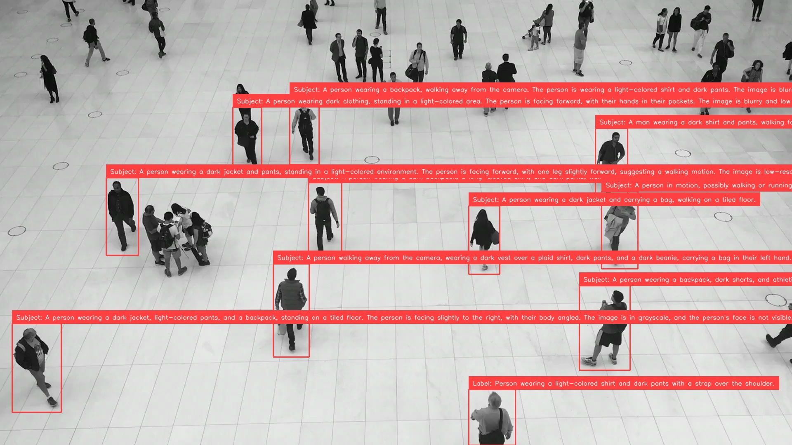
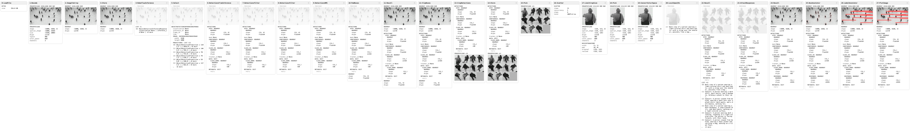

# Detect and Describe

Pipeline source: [run_detect_and_describe.py](https://github.com/trained-by-humans/ml-pipes-supervision/blob/main/examples/run_detect_and_describe.py)

Traditional detection models locate objects and assign class labels, but those
labels rarely tell the whole story. A detector can find a person or a vehicle;
a vision-language model (VLM) can describe what the person is carrying or the
vehicle's visible condition. Combining them adds richer, task-specific information
to detections without training a new detector for every question.

In this recipe, the detector selects the subjects and the VLM answers a question
about each subject's image crop. The responses stay attached to their detections,
ready for annotation, search, or further processing. Unlike classification,
answers need not come from a predefined label set.

## Install dependencies

This example uses local RF-DETR Small and Qwen3-VL, but the same structure applies
to other detectors and VLMs. Install the detector integration and local VLM runtime:

```bash
python -m pip install "ml-pipes-supervision[inference]"
python -m pip install "transformers>=4.57.0,<6" "torch>=2.6" "Pillow>=10"
```

The VLM runtime is an explicit install, not a common package dependency.
Save [qwen_local.py](https://raw.githubusercontent.com/trained-by-humans/ml-pipes-supervision/main/examples/qwen_local.py)
beside your own Python script for the local VLM adapter imported below.

> [!TIP]
> CPU inference can be slow: the default 2B VLM's float32 weights alone need roughly 8 GB,
> plus runtime memory. Use `device="mps"` or `"cuda"` if available.

## Start with the source image

Download Supervision's people-walking image, or use your own image path.

```python
from supervision.assets import ImageAssets, download_assets

source_path = download_assets(ImageAssets.PEOPLE_WALKING, directory=".")
```

## Detect and filter subjects

Choose which subjects to describe before calling the VLM. Filtering irrelevant
or uncertain detections and suppressing duplicates avoids unnecessary requests.

```python
import numpy as np

from ml_pipes.core import Pipeline
from ml_pipes.standard import Select, Store
from ml_pipes.supervision import Detections, ImageToArray
from ml_pipes.supervision.inference import RoboflowInference
from ml_pipes.vision import Decode, LoadFile

pipeline = Pipeline(
    [
        LoadFile(),
        Decode(),
        ImageToArray(),
        Store("source_image"),  # Keep the image for cropping and annotation.
        RoboflowInference(model_id="rfdetr-small", confidence=0.5),
        Select(0),  # Select the result for this image.
        Detections.FromInference(),
        Detections.Filter(lambda detections: np.isin(detections.class_id, (1,))),  # RF-DETR: 1 = person.
        Detections.Filter(lambda detections: detections.confidence >= 0.5),
        Detections.NMS(threshold=0.5),  # Suppress overlapping duplicate detections.
    ],
    auto_validate=True,
)
```

## Prepare a crop for each detection

Give the VLM a focused view of each subject, with a little surrounding context.
Clip expanded boxes to the image and discard unusable regions before cropping.

```{ .py hl_lines="7-11" }
from ml_pipes.standard import Recall

pipeline = Pipeline(
    [
        ...,  # Earlier operators unchanged.
        Detections.NMS(threshold=0.5),
        Detections.ScaleBoxes(1.1),  # 5% padding per side.
        Recall("source_image", prepend=True),
        # Round outward to whole pixels and drop invalid detections.
        Detections.ClipBoxes(rounding="outward", invalid="drop"),
        Detections.Crop(),  # (detections, BGR crops), aligned in the same order.
    ],
    auto_validate=True,
)
```

## Describe each detection

Ask the VLM about each crop using
[Scatter/Gather](https://ml-pipes.com/regions/#scatter-gather), keeping the answers
in detection order. Ground the question in visible evidence and ask the model
to acknowledge uncertainty.

```python
# Use the first line as the annotation label; retain the full response as data.
prompt = (
    "Task:\nDescribe the visible subject's appearance and activity.\n\n"
    "Use only visible evidence in this image crop. "
    "Put a short answer or label on the first line, followed by a brief explanation "
    "on subsequent lines. "
    "If the requested attribute cannot be determined visually, or the crop is too "
    "small, blurry, or obscured, put 'unknown' on the first line and explain why. "
    "Do not guess hidden personal attributes from appearance."
)
```

```{ .py hl_lines="10-20" }
from ml_pipes.standard import Gather, Pick, Scatter
from ml_pipes.vision import ConvertColorSpace

from qwen_local import LocalQwen3VL

pipeline = Pipeline(
    [
        ...,  # Earlier operators unchanged.
        Detections.Crop(),
        Store("detections", source=0),  # Keep the padded, clipped detections.
        Pick(1),  # Pass only the crops to the VLM.
        Scatter(max_concurrency=1),  # This local Qwen adapter requires sequential calls.
        ConvertColorSpace(output_color_space="RGB"),  # Qwen expects RGB crops.
        LocalQwen3VL(
            prompt=prompt,
            model_id="Qwen/Qwen3-VL-2B-Instruct",
            device="cpu",
            max_tokens=256,  # Cap generated response length.
        ),
        Gather(),  # Collect responses in crop order.
    ],
    auto_validate=True,
)
```

## Attach responses to detections

Bring the saved detections back and attach each answer to its subject, so later
steps can use geometry and descriptions together.

```{ .py hl_lines="5-6" }
pipeline = Pipeline(
    [
        ...,  # Earlier operators unchanged.
        Gather(),
        Recall("detections", prepend=True),
        Detections.AttachDataField("response"),  # One aligned value per detection in data["response"].
    ],
    auto_validate=True,
)
```

## Annotate the result

Show each subject's crop region and answer on the original image.

```{ .py hl_lines="7-13" }
from ml_pipes.supervision import BoxAnnotator, LabelAnnotator, PlotImage

pipeline = Pipeline(
    [
        ...,  # Earlier operators unchanged.
        Detections.AttachDataField("response"),
        Recall("source_image", prepend=True),
        BoxAnnotator(),
        LabelAnnotator(
            # Display the first line; the complete response stays in detection data.
            label_formatter=lambda detection: detection.data["response"].splitlines()[0],
        ),
        PlotImage(at=0),  # Display the image from (annotated_image, detections).
    ],
    auto_validate=True,
)
```

## Running the pipeline

Run the completed pipeline to display the annotations and read the full answers.

??? note "Full pipeline"

    This uses the imports and `prompt` defined above.

    ```python
    pipeline = Pipeline(
        [
            LoadFile(),
            Decode(),
            ImageToArray(),
            Store("source_image"),
            RoboflowInference(model_id="rfdetr-small", confidence=0.5),
            Select(0),
            Detections.FromInference(),
            Detections.Filter(lambda detections: np.isin(detections.class_id, (1,))),  # RF-DETR: 1 = person.
            Detections.Filter(lambda detections: detections.confidence >= 0.5),
            Detections.NMS(threshold=0.5),
            Detections.ScaleBoxes(1.1),
            Recall("source_image", prepend=True),
            Detections.ClipBoxes(rounding="outward", invalid="drop"),
            Detections.Crop(),
            Store("detections", source=0),
            Pick(1),  # Select crops from (detections, crops); detections are stored.
            Scatter(max_concurrency=1),  # This local Qwen adapter requires sequential calls.
            ConvertColorSpace(output_color_space="RGB"),
            LocalQwen3VL(
                prompt=prompt,
                model_id="Qwen/Qwen3-VL-2B-Instruct",
                device="cpu",
                max_tokens=256,  # Cap generated response length.
            ),
            Gather(),
            Recall("detections", prepend=True),
            Detections.AttachDataField("response"),
            Recall("source_image", prepend=True),
            BoxAnnotator(),
            LabelAnnotator(
                label_formatter=lambda detection: detection.data["response"].splitlines()[0],
            ),
            PlotImage(at=0),
        ],
        auto_validate=True,
    )
    ```

```python
annotated_image, detections = pipeline(source_path)

for box, response in zip(detections.xyxy, detections.data["response"]):
    print(box.tolist(), response)
```

The result of the run on `ImageAssets.PEOPLE_WALKING`:



The first lines of its first three responses:

```text
[1136.0, 945.0, 1249.0, 1080.0] Label: Person wearing a light-colored shirt and dark pants with a strap over the shoulder.
[1404.0, 693.0, 1527.0, 898.0] Subject: A person wearing a backpack, dark shorts, and athletic shoes, holding a bottle. The person is standing on a tiled floor, facing away from the camera, and appears to be looking up or toward the right. The image is blurry and low resolution, making it difficult to determine exact details.
[662.0, 640.0, 749.0, 866.0] Subject: A person walking away from the camera, wearing a dark vest over a plaid shirt, dark pants, and a dark beanie, carrying a bag in their left hand.
```

First-line labels can still be long or include prefixes such as `Label:` or
`Subject:`, so some annotations are clipped at the image edge. See the
[full responses](../assets/detect_and_describe/responses.json) for all 11 subjects.
Review the descriptions: detector confidence does not measure VLM answer reliability.

## Run the example

The downloaded example contains the completed pipeline and defaults to the
people-walking image:

```bash
python run_detect_and_describe.py
python run_detect_and_describe.py --input people.jpg --prompt "What is this person carrying?"
python run_detect_and_describe.py --help
```

Use `--prompt` to change the question and `--class-ids` to select detector
classes. Run `--help` for all options, including device selection and saving
the results.

## Inspect the Pipeline

Inspect intermediate crops and responses to check that each answer matches its
subject. Save the captured steps as an interactive HTML report:

```python
from ml_pipes.inspection import PipelineInspector

inspection = pipeline.inspect(source_path)  # Runs the models again.
PipelineInspector().save(inspection, "inspection.html")
```

The people-walking run below has 11 detections, 11 aligned responses, and no
failed steps.

[](../assets/detect_and_describe/inspection.html)

*Click the image to open the interactive inspection report.*

## Trace the runs

For a traced run, attach a collector before calling the pipeline. Use this
in place of the untraced call above:

```python
from ml_pipes.collectors import CaptureCollector

collector = CaptureCollector()
pipeline.set_tracing(collector)
annotated_image, detections = pipeline(source_path)

print(collector.last_trace)
```

The outer `Scatter` timing covers processing all crops; its nested trace shows
average per-crop timings. The saved trace below comes from the same
`pipeline.inspect()` invocation as the HTML report, so its total includes
inspection snapshot overhead:

```text
  0:LoadFile                        0.41ms  ( 0.0%)
  1:Decode                          5.64ms  ( 0.0%)
  2:ImageToArray                    0.56ms  ( 0.0%)
  3:Store                           0.01ms  ( 0.0%)
  4:RoboflowInference             356.56ms  ( 0.2%)
  5:Select                          0.22ms  ( 0.0%)
  6:DetectionsFromInference         0.21ms  ( 0.0%)
  7:DetectionsFilter                0.21ms  ( 0.0%)
  8:DetectionsFilter                0.05ms  ( 0.0%)
  9:DetectionsNMS                   0.19ms  ( 0.0%)
  10:DetectionsScaleBoxes           0.11ms  ( 0.0%)
  11:Recall                         0.00ms  ( 0.0%)
  12:DetectionsClipBoxes            0.11ms  ( 0.0%)
  13:DetectionsCrop                 0.43ms  ( 0.0%)
  14:Store                          0.01ms  ( 0.0%)
  15:Pick                           0.02ms  ( 0.0%)
  16:Scatter                     183668.28ms  (99.8%)
    ↳ child trace [n_items=11, concurrency=1]:
      17:ConvertColorSpace              0.17ms  ( 0.0%)
      18:LocalQwen3VL                16696.63ms  (100.0%)
      total                          16697.07ms
  20:Recall                         0.01ms  ( 0.0%)
  21:DetectionsAttachDataField      0.20ms  ( 0.0%)
  22:Recall                         0.00ms  ( 0.0%)
  23:BoxAnnotator                   0.96ms  ( 0.0%)
  24:LabelAnnotator                 2.00ms  ( 0.0%)
  25:PlotImage                     37.54ms  ( 0.0%)
  total                          184081.03ms
```

With local Qwen on CPU (float32, one PyTorch thread), this capture took
**184.08 seconds**, with 99.8% spent in the crop-description region.
The first crop includes lazy Qwen model loading. Qwen weights were already
cached, and detector construction happened before timing. Matplotlib used the
non-interactive Agg backend. This is not a like-for-like speed comparison with
the previous capture: inspection snapshots and generated answer lengths affect
the total.

Download the [text trace](../assets/detect_and_describe/trace.txt) or
[structured trace](../assets/detect_and_describe/trace.json) for this run.
